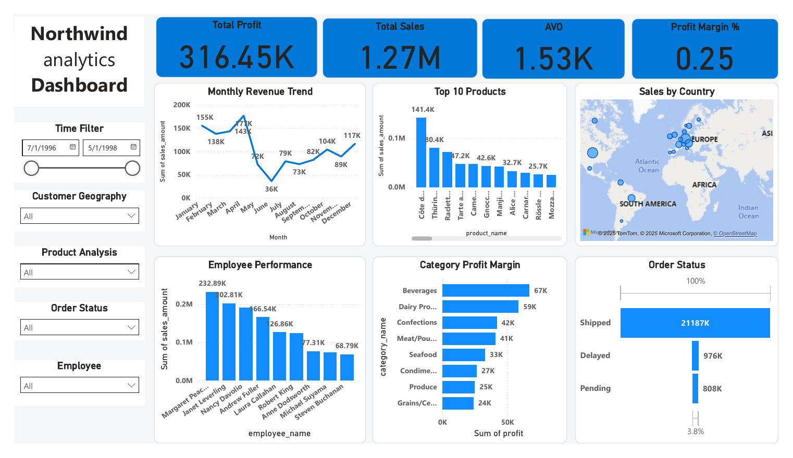

# Northwind Analytics: SQL Queries & Power BI Dashboard

An end-to-end data analysis project on the classic **Northwind** database. It combines 25 analytical SQL queries (PostgreSQL) with an interactive Power BI dashboard covering sales, customers, products, employees and order fulfilment.



## Table of Contents

- [Project Structure](#project-structure)
- [Dashboard Analysis](#dashboard-analysis)
- [Known Limitations & Next Steps](#known-limitations--next-steps)
- [SQL Tasks](#sql-tasks)
- [How to Use](#how-to-use)
- [Tools](#tools)
- [Author & License](#author--license)

## Project Structure

```
.
├── Dashboard/
│   ├── NortWindDashboard.pbix   # Power BI source file
│   ├── NortWindDashboard.pdf    # Static PDF export of the dashboard
│   └── NortWindDashboard.png    # Preview image used in this README
├── dashboards/
│   ├── Ecommerce.jpeg           # Dashboard preview
│   ├── Food_Powerbi.jpeg        # Dashboard preview
│   └── Python.jpeg              # Dashboard preview
└── Sql_Query_Tasks/
    └── northwind.sql            # Northwind schema, data, and 25 query tasks
```

## Dashboard Analysis

The dashboard covers all Northwind orders from **July 1996 to May 1998** (830 orders) and can be filtered by date, customer geography, product, order status and employee.

### Headline KPIs

| KPI | Value | What it tells us |
|---|---|---|
| Total Sales | 1.27M | Net revenue after discounts |
| Total Profit | 316.45K | Estimated profit (see [limitations](#known-limitations--next-steps)) |
| Profit Margin | 25% | Profit as a share of sales |
| Average Order Value (AOV) | 1.53K | Sales divided by number of orders |

### Key Insights

1. **Sales grew strongly over the period.** Based on the order data, sales were about 208K in the second half of 1996, about 617K in 1997, and about 422K in just January to April 1998. That last figure is roughly **2.2x the same four months of 1997**.

2. **Revenue is concentrated in a few products.** Côte de Blaye is the clear best seller at 141.4K, around **11% of all sales**. Together with Thüringer Rostbratwurst (80.4K), the top two products account for about **17.5%** of revenue.

3. **A few employees drive a large share of sales.** Margaret Peacock leads with 232.89K (about 18% of sales), followed by Janet Leverling with 202.81K. The top two together bring in roughly a third of total sales, and the best performer sells about **3.4x more** than the lowest (Steven Buchanan, 68.79K).

4. **Profit is driven by two categories.** Beverages (67K) and Dairy Products (59K) generate about **40% of total profit**. Adding Confections (42K) brings the top three to about **53%**.

5. **Sales are geographically concentrated.** The map shows the largest bubbles in the United States, a notable one in Brazil, and a dense cluster across Western Europe, so Europe and North America are the core markets.

6. **Fulfilment is healthy but not perfect.** Based on the order data, about **93% of orders ship on time** (772), **4.5% ship late** (37) and **2.5% are still pending** (21). Late deliveries are a small but visible area for improvement.

### Visual-by-Visual Breakdown

| Visual | What it shows | Takeaway |
|---|---|---|
| Monthly Revenue Trend | Sales by calendar month | Peaks in April (177K) and January (155K); lowest in June (36K). See the limitation below on how this is calculated |
| Top 10 Products | Best-selling products by sales amount | Steep drop after the top two products, then a long tail between 25K and 50K |
| Sales by Country | Bubble map of sales by customer country | Concentrated in the US, Brazil and Europe |
| Employee Performance | Sales amount per employee | Wide gap between top and bottom performers |
| Category Profit Margin | Profit by product category | Beverages and Dairy Products lead; Grains/Cereals is lowest at 24K |
| Order Status | Funnel of Shipped, Delayed and Pending orders | The vast majority of orders are shipped |

## Known Limitations & Next Steps

While validating the dashboard against the SQL data, a few things were found that affect how the numbers should be read. These are documented here for transparency and are planned improvements.

1. **Order Status funnel sums order IDs instead of counting orders.** The funnel currently displays 21,187K / 976K / 808K, which are totals of the `order_id` column. The correct counts are **772 shipped, 37 delayed and 21 pending**. Fix: use a distinct count of `order_id`.

2. **Monthly Revenue Trend mixes years.** The chart groups by calendar month across all years, so months have different amounts of data behind them. January to April include 1997 and 1998 (a high-growth year), while June has only 1997. This makes the seasonal shape look sharper than it is, and the June low (36K) is mostly a data-coverage effect. Fix: use a Year-Month axis or split the line by year.

3. **Profit is an estimate, not a measured value.** Northwind has no cost data, so profit follows the same assumption used in the SQL tasks: cost equals 75% of unit price, giving a constant 25% margin. As a result, the Category Profit chart is effectively a re-scaling of category sales, and it shows absolute profit rather than margin percentage. Fix: label it as estimated profit, or use real cost data if available.

4. **Small labelling fixes.** The "AVO" card should read "AOV" (Average Order Value), and the "Profit Margin %" card should be formatted as a percentage (25%) rather than 0.25.

5. **The map has no value labels.** Adding data labels or tooltips with sales per country would make the visual easier to read.

## SQL Tasks

`Sql_Query_Tasks/northwind.sql` creates the Northwind tables and data, followed by 25 queries in five groups:

| Group | Topics |
|---|---|
| Sales & Revenue | Monthly revenue trends, top 10 products, sales by country/year, average order value, year-over-year growth |
| Customer & Geography | Top customers by spend, inactive customers, customers per country, churn rate, order frequency |
| Product Performance | 3-month declining sales, margins per category, cross-sold products, percentile ranking, products never ordered |
| Employees & Territories | Sales per employee, revenue contribution %, territory growth, delivery delay, outperformers |
| Advanced / Analytical | Order ranking per customer, latest order, cumulative revenue, seasonality, order status funnel |

SQL concepts used: joins, aggregations, CTEs, subqueries, window functions, date functions.

## How to Use

1. Create a PostgreSQL database:
   ```bash
   createdb northwind
   ```
2. Load the script:
   ```bash
   psql -d northwind -f Sql_Query_Tasks/northwind.sql
   ```
3. Run the queries from the Tasks section at the bottom of the file.
4. Open `Dashboard/NortWindDashboard.pbix` in Power BI Desktop, or view `Dashboard/NortWindDashboard.pdf` for a quick look.

## Tools

- PostgreSQL
- Microsoft Power BI Desktop

## Author & License

**Haider Khan**

Licensed under the Apache License 2.0. See [LICENSE](LICENSE) for details.
